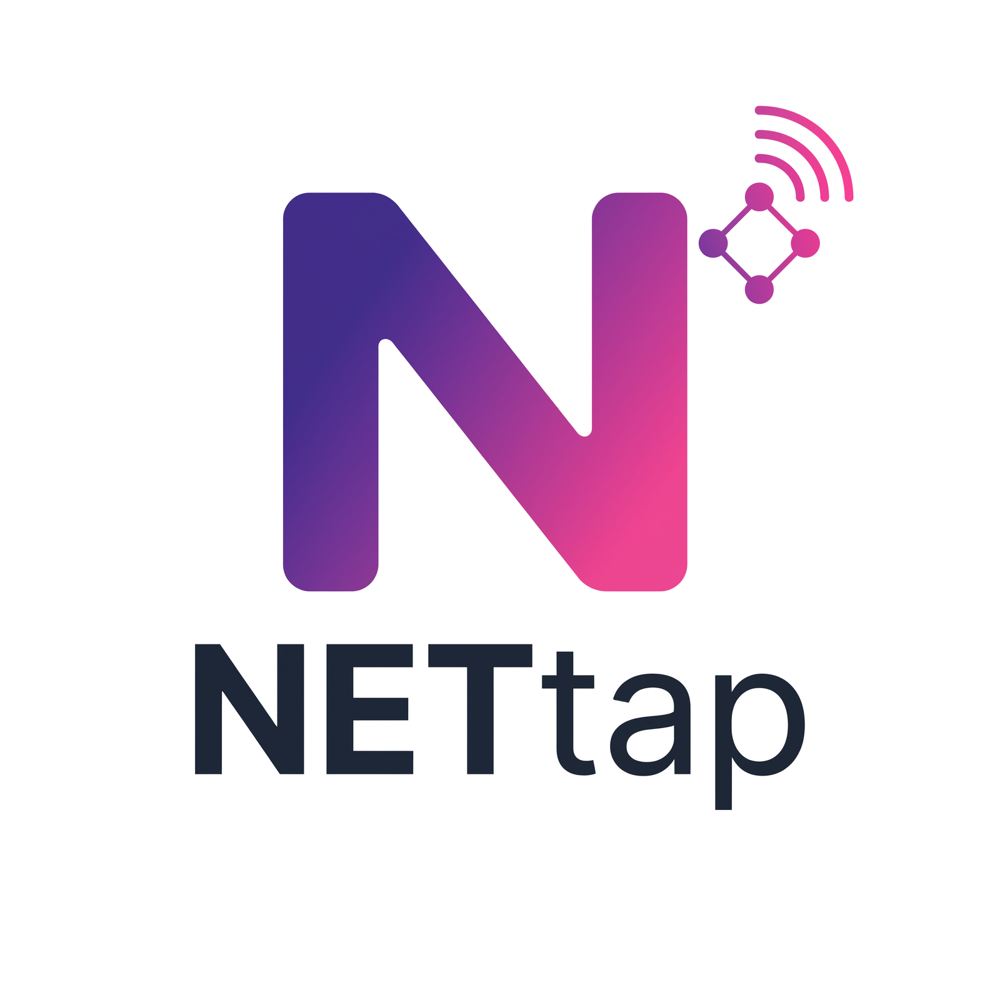
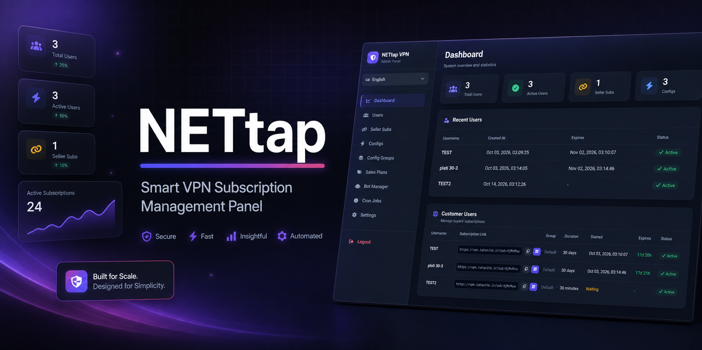
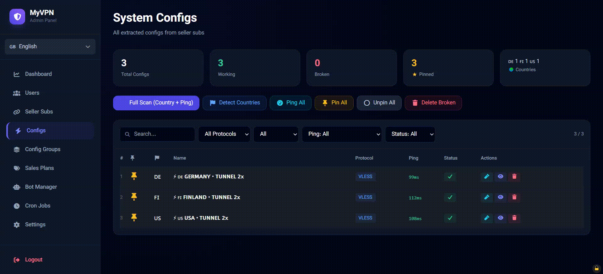
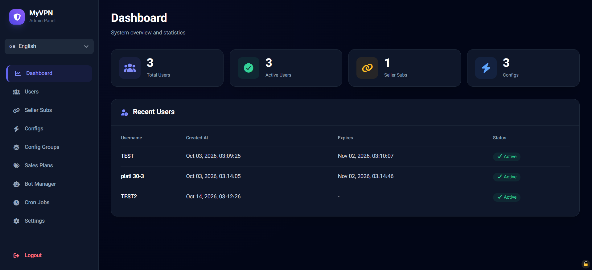
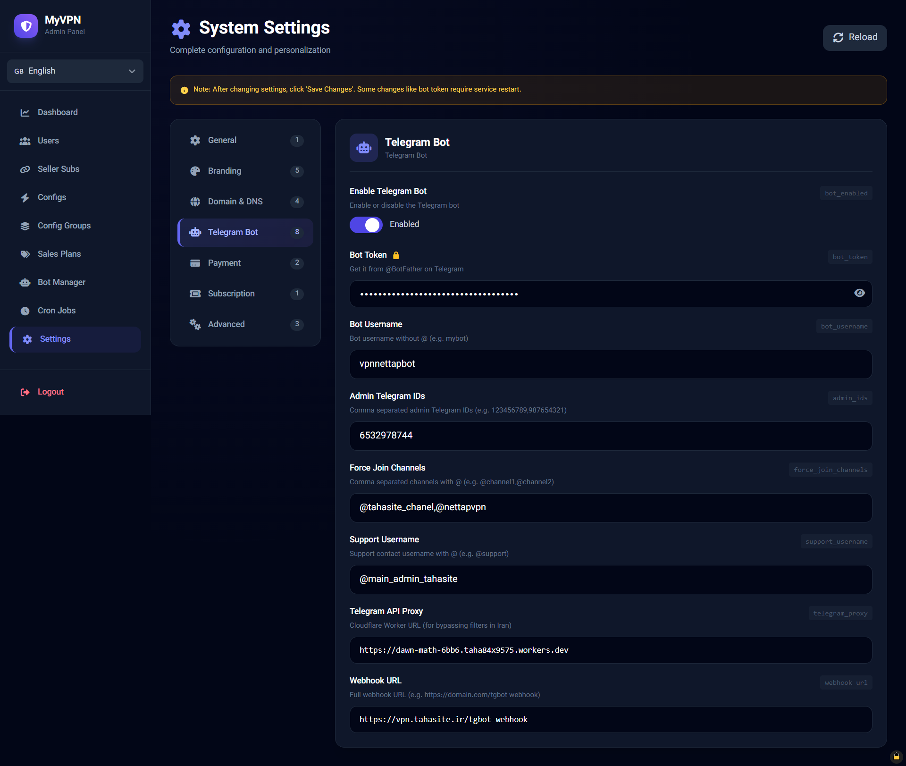
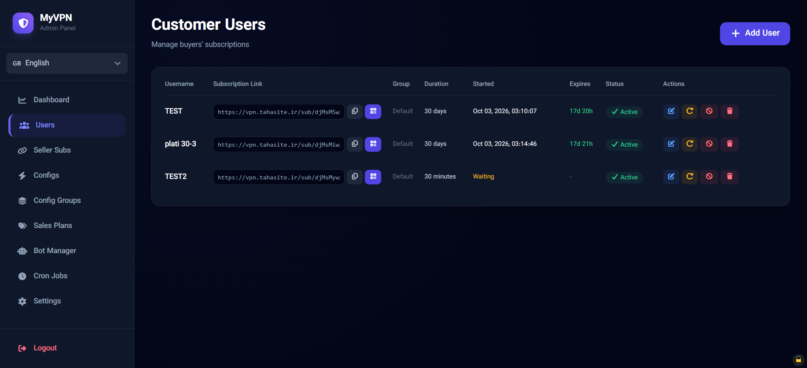
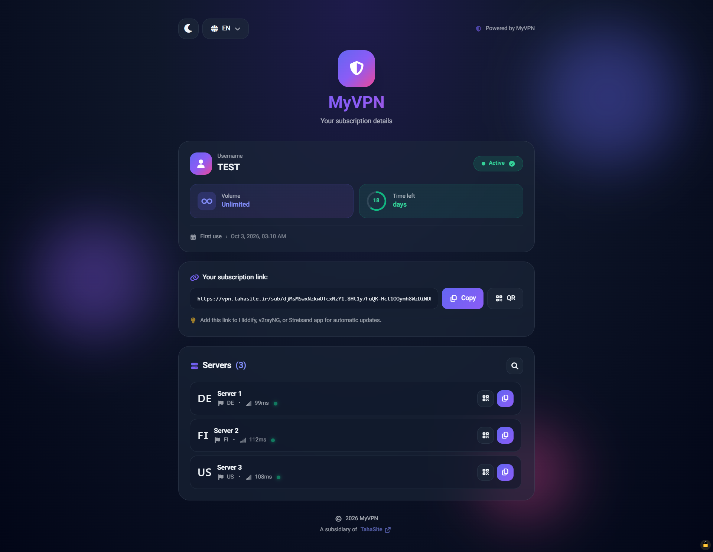
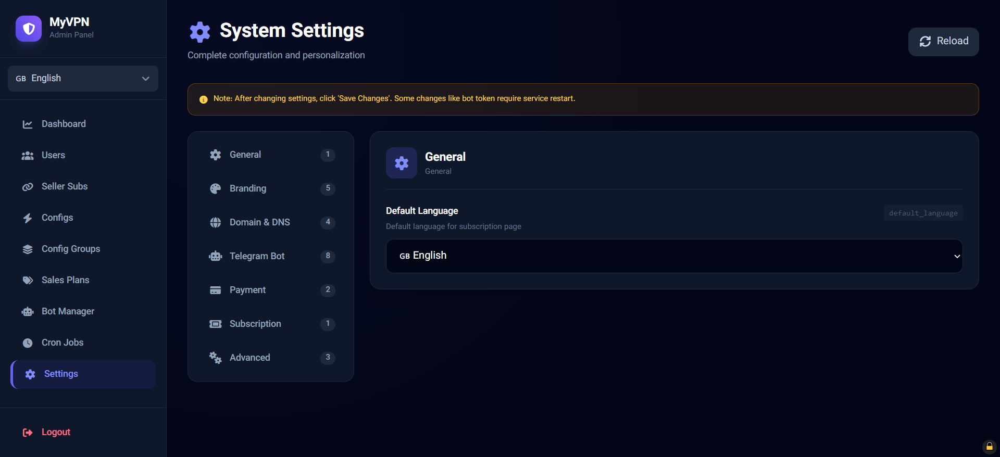

<div align="center">



# 🛡️ NETtap

### Smart VPN Subscription Panel with Integrated Telegram Bot

**Monetize your VPN business with zero-latency DNS forwarding**

[](https://opensource.org/licenses/MIT)
[](https://www.python.org/)
[](https://fastapi.tiangolo.com/)
[](https://core.telegram.org/bots)
[](https://t.me/tahasite_chanel)

[**English**](README.md) • [**فارسی**](README.fa.md)

[Installation](#-quick-installation) • 
[Features](#-features) • 
[Documentation](#-documentation) • 
[Support](#-support)

</div>

---

<br>



<br>

<div align="center">

### 🎬 Quick Demo



</div>

<br>

## 🎯 What is NETtap?

**NETtap** is a professional VPN subscription management panel that acts as an **intelligent DNS proxy** between your customers and VPN providers. Unlike traditional VPN panels, NETtap doesn't route traffic through your server — meaning **zero bandwidth usage, zero speed loss, and unlimited scalability**.

Perfect for anyone who wants to **start a VPN reselling business** without the complexity of managing VPN servers.

### 🔥 How It Works

```
┌─────────────┐    DNS Query    ┌─────────────┐    Direct Connection    ┌──────────────┐
│   Customer  │ ──────────────> │   NETtap    │ ────────────────────── >│ VPN Provider │
└─────────────┘                 │ (Your Server)│                         └──────────────┘
                                └─────────────┘
                                       │
                                  Only DNS passes through
                                  Zero bandwidth usage!
```

<br>

## 💰 Business Potential

### Why Start a VPN Business with NETtap?

| Factor | Details |
|--------|---------|
| 💵 **Startup Cost** | $5/month (one small VPS) |
| 📈 **Profit Margin** | 90-95% |
| 🌍 **Global Market** | Billions of users need VPN access |
| 📊 **Monthly Revenue** | $100-$5,000+ (depends on scale) |
| ⚡ **Setup Time** | 5 minutes with one-command install |

### Revenue Examples:
- **50 users × $3/month** = $150/month profit
- **200 users × $3/month** = $600/month profit
- **1000 users × $3/month** = $3,000/month profit

<br>

## ✨ Features

### 🎨 Modern Admin Panel


- **Multi-language**: English, فارسی, Русский
- **Dark/Light Theme**: Auto-detects user preference
- **Fully Responsive**: Perfect on mobile and desktop
- **Real-time Updates**: Live stats and monitoring

### 🤖 Complete Telegram Bot


- **Auto-Setup Wizard**: One-click bot configuration
- **Force Join Channels**: Grow your Telegram audience
- **Payment System**: Receipt-based manual approval
- **Free Trial System**: Anti-spam with phone verification
- **Referral Program**: 20% commission for referrals
- **Admin Dashboard**: Full control from the bot

### 🌐 Smart DNS System
- **CoreDNS Integration**: Lightning-fast local DNS server
- **Unique Subdomains**: Each user gets personalized domains
- **Instant Blocking**: Block users with one click
- **Zero Traffic Overhead**: Only DNS queries, no VPN traffic

### 👥 User Management


- **Quick Plans**: 30 min to 90 days
- **Group System**: Assign different configs to different users
- **Timer Starts on First Connect**: Fair billing
- **Auto Expiration**: Automated subscription management
- **QR Code Export**: Easy sharing with customers

### 💳 Flexible Payment
- **Card-to-Card**: Receipt verification by admin
- **Multiple Methods**: Easy to extend with new gateways
- **Order Management**: Full order history and tracking

### 📱 Mobile Optimized


- **PWA Ready**: Install as app
- **Touch-Friendly**: Optimized for mobile use
- **RTL Support**: Perfect for Persian/Arabic users

<br>

## 🚀 Quick Installation

### Prerequisites

- Ubuntu 20.04/22.04/24.04 or Debian 11/12
- Root access
- Minimum 1GB RAM, 1 CPU
- A domain name (recommended)

### One-Command Install

```bash
bash <(curl -sSL https://raw.githubusercontent.com/tahasite/nettap/main/scripts/install.sh)
```

That's it! The installer will:

1. ✅ Check system requirements
2. ✅ Install all dependencies (Python, Nginx, CoreDNS)
3. ✅ Set up database and services
4. ✅ Configure SSL certificates
5. ✅ Create admin account
6. ✅ Display login credentials

<br>

## 🎮 CLI Commands

After installation, manage NETtap easily:

```bash
nettap              # Open control menu
nettap start        # Start all services
nettap stop         # Stop all services  
nettap restart      # Restart all services
nettap status       # Check service status
nettap logs         # View real-time logs
nettap update       # Update to latest version
nettap backup       # Create backup
nettap uninstall    # Complete uninstall
```

<br>

## 📸 Screenshots

<div align="center">
  
  
</div>

<br>

## 🏗️ Architecture

```
┌─────────────────────────────────────────────────────────┐
│                     NETtap System                        │
├─────────────────────────────────────────────────────────┤
│                                                          │
│  ┌──────────────┐  ┌──────────────┐  ┌──────────────┐  │
│  │  Admin Panel │  │ Telegram Bot │  │  CoreDNS     │  │
│  │  (HTML/JS)   │  │  (Python)    │  │  (Port 53)   │  │
│  └──────┬───────┘  └──────┬───────┘  └──────┬───────┘  │
│         │                 │                 │          │
│         └─────────┬───────┴─────────────────┘          │
│                   │                                     │
│         ┌─────────▼─────────┐                          │
│         │  FastAPI Backend  │                          │
│         │  (Port 8734)      │                          │
│         └─────────┬─────────┘                          │
│                   │                                     │
│         ┌─────────▼─────────┐                          │
│         │  SQLite Database  │                          │
│         └───────────────────┘                          │
│                                                          │
└─────────────────────────────────────────────────────────┘
```

<br>

## 🛠️ Tech Stack

**Backend:**
- FastAPI (Python 3.10+)
- SQLAlchemy ORM
- SQLite Database
- APScheduler

**Frontend:**
- Vanilla JavaScript
- Tailwind CSS
- FontAwesome Icons
- Multi-language i18n

**Infrastructure:**
- Nginx (Reverse Proxy)
- CoreDNS (Local DNS Server)
- Systemd Services
- Let's Encrypt SSL

**Telegram Bot:**
- python-telegram-bot
- Webhook mode
- Cloudflare Workers proxy support

<br>

## 📚 Documentation

- 📖 [Installation Guide](docs/INSTALL.md)
- ⚙️ [Configuration](docs/CONFIGURATION.md)
- 🤖 [Telegram Bot Setup](docs/TELEGRAM-BOT.md)
- 🔌 [API Documentation](docs/API.md)
- 🐛 [Troubleshooting](docs/TROUBLESHOOTING.md)

<br>

## 🌍 Why NETtap?

### ✅ Advantages

| Feature | NETtap | Traditional VPN Panels |
|---------|--------|----------------------|
| Bandwidth Usage | ❌ Zero | ⚠️ High |
| Server Cost | ✅ $5/month | ❌ $50-500/month |
| Speed Loss | ✅ None | ⚠️ 10-30% |
| Scalability | ✅ Unlimited | ❌ Limited by bandwidth |
| Setup Complexity | ✅ One command | ❌ Complex |
| Business Model | ✅ Reseller-friendly | ⚠️ Infrastructure heavy |

<br>

## 🎓 Perfect For

- 🚀 **Entrepreneurs** starting a VPN business
- 💼 **Resellers** of existing VPN services  
- 👨‍💻 **Developers** learning modern web stack
- 🌐 **Communities** needing private VPN access
- 📱 **Telegram Channel Owners** monetizing with VPN

<br>

## 📊 Comparison

| Feature | NETtap | Marzban | X-UI | 3X-UI |
|---------|--------|---------|------|-------|
| Zero Bandwidth | ✅ | ❌ | ❌ | ❌ |
| Multi-language Panel | ✅ (3 langs) | ⚠️ (2) | ⚠️ (2) | ✅ |
| Built-in Telegram Bot | ✅ | ⚠️ Addon | ❌ | ⚠️ Addon |
| Reseller-Friendly | ✅ | ⚠️ | ❌ | ⚠️ |
| Modern UI | ✅ | ✅ | ⚠️ | ✅ |
| One-Click Install | ✅ | ✅ | ✅ | ✅ |

<br>

## 🤝 Contributing

Contributions are welcome! Please feel free to submit a Pull Request.

1. Fork the repository
2. Create your feature branch (`git checkout -b feature/AmazingFeature`)
3. Commit your changes (`git commit -m 'Add some AmazingFeature'`)
4. Push to the branch (`git push origin feature/AmazingFeature`)
5. Open a Pull Request

<br>

## 📝 License

This project is licensed under the **MIT License** - see the [LICENSE](LICENSE) file for details.

<br>

## ⚠️ Disclaimer

This software is provided for **educational and legitimate business purposes only**. Users are responsible for complying with their local laws and regulations regarding VPN services. The authors are not responsible for any misuse of this software.

<br>

## 💬 Support

Need help? Have questions? Want to suggest a feature?

<div align="center">

### 📢 [Join our Telegram Channel](https://t.me/tahasite_chanel)

**Support • Updates • Community**

[](https://t.me/tahasite_chanel)

</div>

<br>

## ⭐ Star History

If this project helped you, please consider giving it a star! ⭐

It helps others discover NETtap and motivates us to keep improving it.

<br>

## 🙏 Credits

Made with ❤️ by **TahaSite**

Special thanks to all the open-source projects that made NETtap possible:
- [FastAPI](https://fastapi.tiangolo.com/) - Modern web framework
- [CoreDNS](https://coredns.io/) - Flexible DNS server
- [python-telegram-bot](https://python-telegram-bot.org/) - Telegram Bot library
- [Tailwind CSS](https://tailwindcss.com/) - Utility-first CSS

<br>

---

<div align="center">

**[⬆ Back to Top](#-nettap)**

Made with tahasite 💜 for the open-source community

</div>